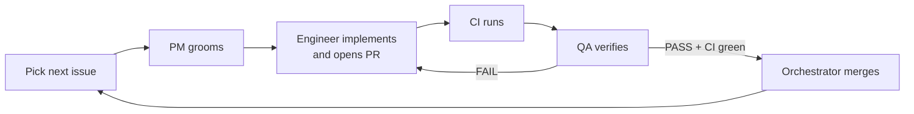

# Process

How work moves from a GitHub issue to merged code. The team is four
agent roles plus one person, the repository owner.

- Tasks are GitHub issues: https://github.com/rasc88/appointment-confirmation/issues
- Every change reaches `main` through a pull request
- Commit regularly, push as you go

## Labels

- `mvp` - needed for the MVP defined in `docs/spec.md`
- `post-mvp` - real work, deliberately not now
- Every issue carries exactly one of the two, new ones included

## Background

- `docs/spec.md` - the product. Where an issue and the spec disagree, the
  groomed issue wins for that task, and the PM updates the spec in the
  same change
- `docs/decisions.md` - the calls already made, with reasons. Read it
  before grooming or implementing, and do not reopen a decision without
  changing it there first
- `AGENTS.md` - the standing commands and rules for whoever works in the
  repository (`CLAUDE.md` is just `@AGENTS.md`, so Claude Code picks it up
  the same way)

## Roles

| Role | Does | Follows | Defined as |
|---|---|---|---|
| Orchestrator | Picks the next issue, launches the other roles, merges | This file | The main Claude Code session |
| PM | Grooms an issue before anyone implements it | `docs/team/pm.md` | `.claude/agents/pm.md` |
| Engineer | Implements one groomed issue and opens its pull request | `docs/team/software-engineer.md` | `.claude/agents/software-engineer.md` |
| QA | Checks the pull request against the acceptance criteria | `docs/team/qa-engineer.md` | `.claude/agents/qa-engineer.md` |
| On-call engineer | Investigates a firing alert and proposes a fix | `docs/team/on-call-engineer.md` | `.claude/agents/on-call-engineer.md` |
| Repository owner (a person) | Promotes releases to production, overrides merges when CI itself is broken | This file | - |

The orchestrator does not groom, implement, or test itself. The PM and
QA agents are defined without the Edit and Write tools, so changing code
is outside their job by construction, not only by instruction.

## Lifecycle

Work is sequential: one issue at a time, one agent at a time.

1. **Pick.** The orchestrator takes the lowest-numbered open `mvp` issue
   whose "Depends on" issues are all closed.
2. **Groom.** The PM rewrites the issue in the task template and comments
   `## PM: groomed`. Do not skip this, even when the task looks obvious.
3. **Branch.** The orchestrator creates `issue-<n>` from the latest `main`.
4. **Implement.** The engineer implements on that branch, pushes, opens a
   pull request whose description starts with `Closes #<n>`, and comments
   `## Engineer: ready for QA` on the issue.
5. **CI.** GitHub Actions runs lint, typecheck, and tests on the pull
   request (once the CI issue has landed).
6. **Verify.** QA checks out the branch, runs the checks, and posts
   `## QA: PASS` or `## QA: FAIL` on the issue.
7. **On FAIL**, back to step 4 with the QA comment as input. After three
   FAILs on the same issue, the orchestrator stops and asks the
   repository owner.
8. **On PASS with CI green**, the orchestrator squash-merges the pull
   request, which closes the issue, and pulls `main`.
9. Repeat until no `mvp` issue is open.

The headings `## PM: groomed`, `## Engineer: ready for QA`, and
`## QA: PASS` / `## QA: FAIL` are what make the work traceable on the
issue. Every role uses them exactly.

## Branches and pull requests

- One issue, one branch, one pull request: `issue-<n>`
- The engineer pushes the branch as soon as it has a commit, and after
  each round of QA fixes. Work nobody can see is work nobody can review
- If `main` moved while the issue was in progress, the engineer merges
  `main` into the branch before asking for QA again. Never rebase a
  pushed branch: that needs a force-push, which stops the run until a
  person approves it, and squash-merging makes a clean history anyway
- Only the orchestrator merges, always by squash. Nobody force-pushes
- Changes to `backend/prisma/schema.prisma` include their migration in the
  same pull request. A schema change without a migration is a FAIL

## Protecting `main`

Once the CI issue has landed, `main` is protected on GitHub:

- Changes only through a pull request
- The CI checks must pass before merging
- The branch must be up to date with `main` before merging

Administrators are not bound by the rule. The repository owner may merge
with failing CI only when CI itself is broken (a GitHub outage, an expired
secret), not when the change is failing its tests. When they do, they
comment on the pull request with the reason. Agents never bypass the rule.

## Releases

- Every merge to `main` builds one image and deploys it to **dev**
  automatically
- **Production** changes only when the repository owner runs the promotion
  workflow by hand. It deploys the exact image already running on dev.
  No agent runs it

## Destructive commands stall the run

Commands that destroy things ask the person running the session for
approval, so the work stops until someone is at the keyboard. Nothing in
this process deletes: not branches, not databases, not temporary files.

- Undo an edit with `git checkout -- <path>` or `git restore <path>`,
  never by copying a file aside and deleting the copy. After restoring,
  `git status` and `git diff HEAD` must both be empty
- Temporary files go in the session scratchpad, outside the repository
- Leave merged branches in place
- Never `pkill` or `docker rm` something you did not start. Stop a
  background job by the id the tool gave you

If something has to be removed, say what and why, and let the repository
owner do it.

## Long-running commands

Run tests in the foreground and read the result. Nothing wakes an agent
that has stopped, so a backgrounded command that is never checked is
where the work ends. If a suite takes longer than a few minutes, say so -
"did not finish within five minutes" is a finding, not silence.
