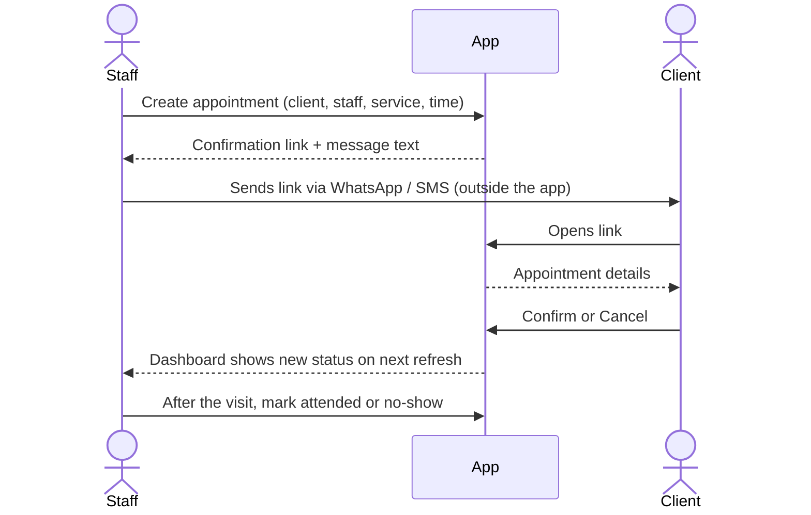
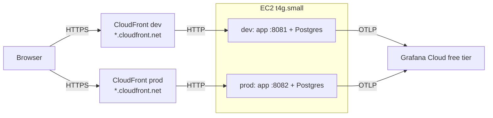

# Appointment Confirmation

## Product and Technical Specification — MVP v1.0

**Status:** Draft  
**Date:** November 10, 2026  
**Audience:** Product, Engineering, QA, and Operations  

---

## 1. Product Summary

Small service businesses (salons, physiotherapists, tutors, repair shops) lose income when clients miss appointments without warning. The slot stays empty, and the staff member who kept it free earns nothing.

**Appointment Confirmation** is a browser-based tool for a single business with several staff members. Staff record upcoming appointments, send each client a private confirmation link through the messaging app they already use, and see on one dashboard which appointments are confirmed, cancelled, or **at risk** of becoming a no-show. Clients open the link on their phone and confirm or cancel with one tap, without creating an account.

After each appointment, staff mark it as attended or no-show. That history feeds back into the at-risk rules, so repeat no-shows stand out before their next visit.

---

## 2. Goals

The MVP must:

1. Allow staff to sign in with email and password.
2. Allow staff to create, edit, confirm, and cancel appointments for any staff member, for example when a client replies by phone instead of using the link.
3. Generate a unique, unguessable confirmation link per appointment that staff can copy and send themselves.
4. Allow clients to confirm or cancel through that link without an account.
5. Show a dashboard for a chosen day, grouped by status, with at-risk appointments highlighted.
6. Allow staff to mark past appointments as attended or no-show, and keep each client's history.
7. Persist all data in PostgreSQL.

---

## 3. Non-Goals for MVP

The following are intentionally excluded:

- Sending SMS, email, or WhatsApp messages from the app. Staff send the link themselves.
- Automatic reminders or scheduled jobs.
- Online self-booking by clients, or rescheduling through the link.
- Deposits, payments, or cancellation fees.
- Multiple businesses (multi-tenant). One deployment serves one business.
- Roles and permissions between staff. All staff are equal.
- Different rules per service or per staff member. Settings apply to the whole business.
- Calendar sync (Google Calendar, Outlook) or overlap detection between appointments.
- Real-time push updates. The dashboard refreshes by polling.
- Native mobile apps. The web UI is responsive instead.
- High availability. One instance hosts both environments, and an instance failure takes both down until it is replaced.
- Languages other than English in the UI. Each business can still write the client message in its own language (6.7).

---

## 4. Users and Roles

### 4.1 Staff Member
An authenticated user of the business who can:
- Sign in and sign out with email and password.
- Add other staff accounts.
- Create, edit, and cancel appointments for any staff member.
- Confirm or cancel an appointment on the client's behalf, when the client replies by phone, message, or in person.
- Copy an appointment's confirmation link or ready-to-send message.
- Regenerate a confirmation link, which invalidates the previous one.
- View the dashboard for any day, optionally filtered by staff member.
- Mark past appointments as attended or no-show.
- View a client's appointment history and no-show count.

### 4.2 Client
An unauthenticated visitor holding a confirmation link who can:
- See the business name, service, staff member, date, and time of their appointment.
- Confirm the appointment.
- Cancel the appointment.
- Not see any other client's data, or any appointment other than their own.

---

## 5. Core User Flows



### 5.1 Creating an Appointment
Staff pick an existing client or create a new one (name, optional phone), choose the staff member, enter the service name, start time, and duration (pre-filled with the default duration from settings). The app creates the appointment in `pending` status with a fresh confirmation token and shows a **Copy link** button and a **Copy message** button. The message is built from the message template in settings, so each business can use its own wording and language.

### 5.2 Client Confirms or Cancels
The client opens `/c/{token}`. If the appointment is `pending`, they see **Confirm** and **Cancel**. If already `confirmed`, they see the confirmation and a **Cancel** option. Cancelling asks for a second tap to prevent accidents: the first tap shows a **Cancel this appointment?** prompt with **Keep appointment** and **Yes, cancel it**, and the prompt has no timeout. A cancelled appointment shows a cancelled page with no actions, whoever cancelled it. After the appointment start time, the link shows a read-only "this appointment has passed" page. If a confirm or cancel is rejected with `409` because the appointment changed meanwhile, the page reloads the appointment, shows its current state, and says the answer was not saved.

### 5.3 Daily Dashboard
Staff open the dashboard, which defaults to today in the business time zone. Appointments are grouped as **At risk**, **Pending**, **Confirmed**, **Cancelled**, **Needs outcome**, and **Completed** (attended or no-show), in that order, each sorted by start time. Each appointment is in exactly one group, decided in this order: `cancelled` is Cancelled; `attended` or `no_show` is Completed; a `pending` or `confirmed` appointment whose start time has passed is Needs outcome; a `pending` or `confirmed` appointment with at least one at-risk reason is At risk; otherwise `pending` is Pending and `confirmed` is Confirmed (decision 23). A date picker and a staff filter narrow the view. The page polls for updates every 30 seconds.

### 5.4 Staff Confirms or Cancels for the Client
When a client replies outside the link (a phone call, a chat message, or at the front desk), staff open the appointment on the dashboard and tap **Confirm** or **Cancel**. Cancelling asks for a second tap, as on the client page. The appointment records that staff made the change, so the dashboard can show "Confirmed by staff" or "Confirmed by client".

### 5.5 Closing the Day
For each appointment whose start time has passed, staff mark **Attended** or **No-show**. Unmarked past appointments stay visible in a "Needs outcome" group until marked.

---

## 6. Functional Requirements

### 6.1 Authentication and Staff Accounts
- Email and password sign-in. Passwords are hashed with `bcryptjs` (cost 12).
- The session is a signed token in an `HttpOnly`, `Secure`, `SameSite=Lax` cookie, valid for 12 hours.
- Any signed-in staff member can add a staff account (name, email, initial password).
- Staff accounts cannot be deleted in the MVP. They can be marked inactive, which blocks sign-in, hides them from the staff picker, and ends their existing sessions (their next request returns `401`).
- A staff member cannot deactivate themselves (`409`), so the last active account cannot lock everyone out.

### 6.2 Clients
- A client has a name and an optional phone number.
- Staff can search clients by name or phone when creating an appointment.
- A client page lists their appointments and their no-show count.

### 6.3 Appointments
- Fields: client, staff member, service name, start time, duration in minutes.
- Staff can edit the staff member, service, start time, and duration while the appointment is `pending` or `confirmed`. Editing the start time resets status to `pending`, because the client confirmed a different time.
- The client of an appointment cannot be changed after creation. The link has already gone to that client; staff cancel and create a new appointment instead.
- A new start time, on create or edit, must be in the future.
- Staff can confirm a `pending` appointment before its start time. The confirmation records that it was confirmed by staff.
- Staff can cancel a `pending` or `confirmed` appointment. The cancellation records that it was cancelled by staff.

### 6.4 Confirmation Link
- The link is `/c/{token}`, where the token is at least 128 bits of cryptographically random data, URL-safe encoded.
- The token is stored hashed, so a database leak does not expose working links.
- The link stops accepting actions once the appointment has started.
- Regenerating a link invalidates the previous token immediately.
- A link can be regenerated only while the appointment is `pending` or `confirmed` and before its start time.

### 6.5 At-Risk Rules
An appointment is **at risk** when it is `pending` or `confirmed` and any of these is true:

| Rule | Condition | Shown reason |
|---|---|---|
| No reply | Status is `pending` and the start time is within `noReplyWindowHours` | "No reply yet" |
| History | The client has at least `noShowThreshold` `no_show` appointments in the last `noShowLookbackDays` | "Missed N before" |

A cancellation made less than `lateCancellationHours` before the start time is flagged **Late cancellation**, so staff know the slot may still be refillable.

How the rules are measured:

- At-risk reasons apply only before `startsAt`. Once an appointment has started it gets none and belongs to "Needs outcome".
- The no-reply window is inclusive: an appointment exactly `noReplyWindowHours` from its start has no reply yet.
- History counts the client's `no_show` appointments whose `startsAt` is within the last `noShowLookbackDays × 24 h` (inclusive), not counting the appointment itself. N in "Missed N before" is that windowed count, not the all-time count.
- Late cancellation is measured from `statusChangedAt`, the time of the cancellation, and is strictly "less than" `lateCancellationHours`. A cancellation at or after the start is late. With `lateCancellationHours` 0 the flag is off.
- Every window is elapsed time (hours × 3,600,000 ms, days × 86,400,000 ms), independent of the business time zone, so around a DST change a window can differ by one hour from the local wall clock.

All thresholds come from business settings (6.7). The rules are pure functions that take the appointment, the client's history, the settings, and the current time, so they are unit-tested without a database.

Changing a setting applies immediately to every upcoming appointment, because at-risk reasons are calculated when the dashboard loads, not stored.

### 6.6 Dashboard
- Defaults to today in the business time zone.
- Shows each appointment's time, client name, staff member, service, status, and at-risk reasons.
- Shows counts per group at the top.
- Refreshes every 30 seconds without a full page reload.

### 6.7 Business Settings
One settings record per deployment, edited by any staff member on a **Settings** page. Every setting has a default, so the app works before anyone opens the page.

| Setting | Default | Allowed values | Used for |
|---|---|---|---|
| `businessName` | "My Business" | 1–80 characters | Client page and message |
| `timeZone` | `UTC` | Any IANA zone, for example `Europe/Madrid` | Dashboard day, all displayed times |
| `noReplyWindowHours` | 24 | 1–168 | "No reply yet" rule |
| `noShowThreshold` | 1 | 1–10 | "Missed N before" rule |
| `noShowLookbackDays` | 180 | 7–730 | "Missed N before" rule |
| `lateCancellationHours` | 12 | 0–168 (0 turns the flag off) | "Late cancellation" flag |
| `defaultDurationMinutes` | 30 | 5–480 | Pre-fills new appointments |
| `messageTemplate` | See below | 1–500 characters, must contain `{link}` | **Copy message** text |

Default message template:

```
Hi {client}, this is {business}. Please confirm your {service} appointment on {date} at {time}: {link}
```

Placeholders: `{client}`, `{business}`, `{service}`, `{staff}`, `{date}`, `{time}`, `{link}`. Unknown placeholders are rejected when saving, so a typo can't reach a client.

- A placeholder is a `{`, then any characters other than `{` and `}`, then `}`. Placeholders are case-sensitive, so `{Link}` and `{ link }` are unknown. A lone `{` or `}` is plain text.
- `{date}` is the start date as `DD/MM/YYYY` and `{time}` the start time as 24-hour `HH:mm`, both in the business time zone.
- The 500 limit counts Unicode characters (code points), as JSON Schema `maxLength` does, and applies to the template only, not to the rendered message.

- Settings are validated on save, and invalid values return `422` with the field that failed.
- Changing `timeZone` does not move appointments. Times are stored in UTC, so the same moment is shown in the new zone.

---

## 7. Appointment State Machine

| From | Action | Actor | To |
|---|---|---|---|
| — | Create | Staff | `pending` |
| `pending` | Confirm (before start) | Client or Staff | `confirmed` |
| `pending`, `confirmed` | Cancel | Client or Staff | `cancelled` |
| `confirmed` | Change start time | Staff | `pending` |
| `pending`, `confirmed` | Mark attended (after start) | Staff | `attended` |
| `pending`, `confirmed` | Mark no-show (after start) | Staff | `no_show` |
| `attended`, `no_show` | Undo outcome | Staff | `confirmed` if `confirmedBy` is set, otherwise `pending` |

- `cancelled` is final in the MVP. A client who changes their mind contacts the business, and staff create a new appointment.
- Changing the start time clears `confirmedBy`, so a later undo of an outcome returns to `pending`.
- Confirming an already `confirmed` appointment succeeds without changes, so double taps are harmless.
- Any other transition is rejected with `409 Conflict`.

---

## 8. UX Layout and Responsive Design

- **Client page:** mobile-first, a single card with the appointment details and large buttons. No navigation, no sign-in prompt.
- **Staff dashboard:** works from 360 px wide. On narrow screens the groups stack as collapsible sections, and on desktop they show as a list with a sticky header for date and filters.
- Times are always shown in the business time zone, with the zone named on the client page (for example "10:30, Europe/Madrid").
- The client page spells out the date, for example "Tuesday, 10 November 2026", in `en-GB` and the business time zone (decision 22).

---

## 9. Permissions Matrix

| Action | Anonymous | Client (valid token) | Staff |
|---|---|---|---|
| View own appointment via link | — | ✅ | ✅ |
| Confirm / cancel via link | — | ✅ (before start) | — |
| Sign in | ✅ | ✅ | ✅ |
| View dashboard, clients, history | — | — | ✅ |
| Create / edit appointments | — | — | ✅ |
| Confirm / cancel from the dashboard | — | — | ✅ (confirm before start) |
| Mark attended / no-show | — | — | ✅ |
| Add or deactivate staff | — | — | ✅ |
| View and edit business settings | — | — | ✅ |

---

## 10. Technical Architecture

### 10.1 Stack

| Layer | Choice |
|---|---|
| Frontend | Vite + React + TypeScript, React Router, plain CSS |
| Backend | Node.js 24 LTS, Express 5, TypeScript |
| Validation | Zod, matching the OpenAPI contract |
| Database | PostgreSQL 17 via Prisma (schema, migrations, client) |
| API contract | `openapi.yaml`, written before the backend |
| Tests | Vitest + Supertest (backend), Vitest + React Testing Library (frontend), Playwright (end to end) |
| Containers | One Dockerfile (frontend built into the backend image), Docker Compose with Postgres |
| Hosting | One AWS EC2 `t4g.small` running dev and production as separate Docker Compose projects, each behind its own CloudFront distribution for HTTPS, defined in CloudFormation (10.4) |
| Image registry | GitHub Container Registry, public package |
| CI/CD | GitHub Actions: tests on every PR, auto-deploy to dev on `main`, manual promotion of the same image to production, deploys run over AWS Systems Manager |
| Telemetry | OpenTelemetry (traces, metrics, logs) exported over OTLP straight from the app to Grafana Cloud's free tier |

### 10.2 Runtime Layout
A single container serves the API under `/v1` and the built frontend as static files, so the browser always talks to the same origin. Locally, `docker compose up` starts the app and Postgres with one command, applies Prisma migrations, and seeds demo data.

### 10.3 Configuration
| Variable | Purpose |
|---|---|
| `DATABASE_URL` | Postgres connection string |
| `SESSION_SECRET` | Signs session tokens |
| `PUBLIC_BASE_URL` | Used to build confirmation links |
| `APP_ENV`, `APP_VERSION` | Environment and image tag, reported by `/health` and telemetry |
| `OTEL_EXPORTER_OTLP_ENDPOINT`, `OTEL_EXPORTER_OTLP_HEADERS` | Telemetry export; off when unset |

Environment variables hold only deployment and secret values. Everything about how the business works lives in business settings (6.7), so it can change without a redeploy.

### 10.4 Deployment Layout and Cost
The deployment is sized for the lowest cost that still gives separate dev and production environments.



- **One instance, two environments.** Dev and production are separate Docker Compose projects on the same instance, each with its own app container, Postgres container, data volume, and env file. They share only the host.
- **HTTPS without a domain.** Each environment gets its own CloudFront distribution with its default `*.cloudfront.net` address and certificate. CloudFront terminates HTTPS and forwards to the app's port over HTTP. The security group opens ports 8081 and 8082 only to CloudFront's origin-facing IP list, so the instance doesn't answer the public internet directly. No reverse proxy runs on the instance.
- **No caching.** The distributions forward every method, header, cookie, and query string, because every response is dynamic.
- **Memory limits.** Each container has a memory limit, so a misbehaving dev deploy cannot starve production.
- **No collector.** The app exports telemetry directly to Grafana Cloud, which saves running a collector on a small instance.

Expected monthly cost:

| Item | Cost |
|---|---|
| EC2 `t4g.small` | $0 under AWS's t4g.small free trial (750 hours/month, one instance), which runs until December 31, 2026; about $12/month after |
| Public IPv4 address | About $3.65/month, covered by AWS Free Tier credits on new accounts |
| 20 GiB gp3 EBS volume | About $1.60/month |
| CloudFront (2 distributions) | $0 within the always-free allowance |
| GitHub Container Registry, GitHub Actions | $0 for a public repository |
| Grafana Cloud | $0 on the free tier |

Once peer review is over, deleting the CloudFormation stack stops all AWS charges.

---

## 11. Data Model

All timestamps are stored in UTC. Ids marked `uuid` are text columns holding a UUID, so a malformed id finds nothing and returns `404`. There is no session table: sessions are signed cookies (decision 17).

### StaffMember
| Field | Type | Notes |
|---|---|---|
| id | uuid | |
| name | text | |
| email | text | unique, lowercase |
| passwordHash | text | |
| isActive | boolean | default true |
| createdAt | timestamp | |

### Client
| Field | Type | Notes |
|---|---|---|
| id | uuid | |
| name | text | |
| phone | text, nullable | |
| createdAt | timestamp | |

### Appointment
| Field | Type | Notes |
|---|---|---|
| id | uuid | |
| clientId | uuid | FK Client |
| staffMemberId | uuid | FK StaffMember |
| service | text | |
| startsAt | timestamp | |
| durationMinutes | integer | 5–480 |
| status | enum | `pending`, `confirmed`, `cancelled`, `attended`, `no_show` |
| confirmedBy | enum, nullable | `client`, `staff` |
| cancelledBy | enum, nullable | `client`, `staff` |
| statusChangedAt | timestamp | |
| tokenHash | text | unique, SHA-256 of the confirmation token |
| createdAt, updatedAt | timestamp | |

### BusinessSettings
A single row. The defaults from 6.7 are column defaults, and the server creates the row at start if it is missing.

| Field | Type | Notes |
|---|---|---|
| id | integer | always 1 |
| businessName | text | |
| timeZone | text | IANA zone |
| noReplyWindowHours | integer | |
| noShowThreshold | integer | |
| noShowLookbackDays | integer | |
| lateCancellationHours | integer | |
| defaultDurationMinutes | integer | |
| messageTemplate | text | |
| updatedAt | timestamp | |
| updatedByStaffId | uuid, nullable | FK StaffMember |

Indexes: `Appointment(startsAt)`, `Appointment(clientId, status)`, unique `Appointment(tokenHash)`.

---

## 12. API Surface

All endpoints are under `/v1` and defined in `openapi.yaml`. Errors use a single JSON shape: `{ "error": { "code", "message", "field"? } }`. `field` is present only on `422` and names the request field or query parameter that failed.

### 12.1 Staff (session cookie required)
| Method | Path | Purpose |
|---|---|---|
| POST | `/auth/login` | Sign in |
| POST | `/auth/logout` | Sign out |
| GET | `/auth/me` | Current staff member |
| GET, POST | `/staff` | List / add staff |
| PATCH | `/staff/{id}` | Rename or deactivate |
| GET, POST | `/clients` | Search (`?q=`) / create |
| GET | `/clients/{id}` | Client with history and no-show count |
| GET | `/appointments?date=YYYY-MM-DD&staffId=` | Day view with at-risk reasons |
| POST | `/appointments` | Create; returns the confirmation link once |
| PATCH | `/appointments/{id}` | Edit fields |
| POST | `/appointments/{id}/confirm` | Confirm by staff |
| POST | `/appointments/{id}/cancel` | Cancel by staff |
| POST | `/appointments/{id}/outcome` | `{ "outcome": "attended" \| "no_show" }` |
| POST | `/appointments/{id}/undo-outcome` | Revert an outcome |
| POST | `/appointments/{id}/link` | Regenerate link; returns the new link once |
| GET, PATCH | `/settings` | Read / update business settings |

Because only the token hash is stored, the full link is returned only when it is created or regenerated, once, together with the message template rendered with that link. The UI keeps both in memory so staff can copy them right away; if lost, staff regenerate the link.

Sign-out (`POST /auth/logout`) needs no valid session and always returns `204`, so an expired session can still sign out.

### 12.2 Client (token in path, no session)
| Method | Path | Purpose |
|---|---|---|
| GET | `/public/appointments/{token}` | Appointment details for the client page, including business name and time zone |
| POST | `/public/appointments/{token}/confirm` | Confirm |
| POST | `/public/appointments/{token}/cancel` | Cancel |

Unknown or invalidated tokens return `404`, never a hint about whether the appointment exists.

A client confirm or cancel on a `cancelled`, `attended` or `no_show` appointment is `409 invalid_transition`, even after the start time. `409 appointment_started` applies only to `pending` and `confirmed` appointments whose start time has passed.

### 12.3 Operations
| Method | Path | Purpose |
|---|---|---|
| GET | `/health` | Database round trip, plus `environment` and `version` |

---

## 13. Security and Privacy

- Client names, phone numbers, and confirmation tokens never appear in logs, traces, or metrics.
- Request URLs for `/c/{token}` and `/v1/public/appointments/{token}` are recorded only by their route template, never the raw path.
- Public endpoints are rate-limited per IP (for example 30 requests per minute) to slow token guessing. Behind CloudFront, the client IP comes from the `X-Forwarded-For` header CloudFront adds.
- Sign-in is rate-limited per email and IP.
- All state-changing staff endpoints require the session cookie and reject cross-site requests: a request whose `Origin` header is not the app's own origin is rejected with `403`.
- Secrets come only from environment variables, never from the repository.

---

## 14. Performance and Reliability Targets

- Client page loads and confirm action: p95 under 500 ms on the deployed environment.
- Dashboard for a day with 100 appointments: p95 under 800 ms.
- Expected scale: up to 20 staff and 300 appointments per day. One small instance shared by both environments is enough.

---

## 15. Observability and Alerting

The key user journey is **client opens link → confirms or cancels**. It is instrumented with traces, metrics, and structured JSON logs that share the trace ID. All three are sent to Grafana Cloud's free tier, where they are stored, viewed, and alerted on. Metric labels are limited to the ones below, so the number of series stays well within the free tier's limits.

### 15.1 Application Metrics
| Metric | Type | Labels |
|---|---|---|
| `appointments_created_total` | counter | `environment`, `version` |
| `appointment_responses_total` | counter | `action` (`confirm`, `cancel`), `actor` (`client`, `staff`), `environment`, `version` |
| `appointment_response_failures_total` | counter | `action`, `actor`, `environment`, `version` |
| `appointment_outcomes_total` | counter | `outcome` (`attended`, `no_show`), `environment`, `version` |

### 15.2 Alert
**Clients cannot confirm:** fires when 3 or more `appointment_response_failures_total` increments occur within 5 minutes in one environment, sustained for 2 minutes. Each alert carries `service`, `environment`, `version`, and `severity` labels and a link to the dashboard filtered to that environment and version.

### 15.3 On-Call Agent
When the alert fires, a coding agent receives the alert, investigates with logs and traces, writes a fix with a test on a branch, and opens a pull request for human review. It never deploys to production.

---

## 16. MVP Acceptance Criteria

1. `docker compose up` starts the app and Postgres, seeds demo data, and the app is usable at `http://localhost:8080`.
2. A staff member can sign in with the seeded account, create an appointment, and copy its link.
3. Opening that link in a private window shows the appointment and lets the client confirm.
4. The staff dashboard shows the appointment as `confirmed` within 30 seconds, without a manual reload.
5. With default settings, a `pending` appointment starting within 24 hours appears under **At risk** with "No reply yet".
6. A client with a previous no-show is flagged on their next appointment.
7. After the start time, the link no longer accepts confirm or cancel.
8. Staff can confirm or cancel an appointment from the dashboard, and it shows whether the client or staff made the change.
9. Changing `noReplyWindowHours` on the Settings page changes which appointments show "No reply yet" on the next dashboard refresh.
10. Regenerating a link makes the old link return 404.
11. Unit, integration, and end-to-end tests run with one command each and pass in CI.
12. No client name, phone number, or token appears in exported logs or traces.

---

## 17. Demo Seed Data

- Business settings with name "Demo Studio", time zone `Europe/Madrid`, and the other settings at their defaults.
- Two staff accounts: `alex@demo.test` and `sam@demo.test`, password `demo1234`.
- Eight clients, two of them with past no-shows.
- Appointments today and tomorrow covering every status and every at-risk rule.

---

## 18. Delivery Phases

1. **Spec and contract:** this document, `openapi.yaml`, `AGENTS.md`, and the GitHub Issues backlog.
2. **Frontend prototype:** staff dashboard and client page against a mocked API.
3. **Backend:** Express + Prisma implementation of the contract, with unit and integration tests.
4. **Connect:** frontend on the real API, end-to-end test of the confirm journey.
5. **Containerize:** Dockerfile and Docker Compose with Postgres.
6. **Deploy:** one CloudFormation stack (EC2 instance, two CloudFront distributions) on AWS, CI/CD with manual promotion to production.
7. **Operate:** OpenTelemetry, Grafana dashboard, alert, and on-call agent.

---

## 19. Decisions

| Question | Decision |
|---|---|
| Domain for HTTPS | CloudFront's default `*.cloudfront.net` domain, one per environment |
| Instance size | One `t4g.small` shared by dev and production, free under AWS's trial until December 31, 2026 |
| Observability backend | Grafana Cloud free tier |
| UI language | English only |
